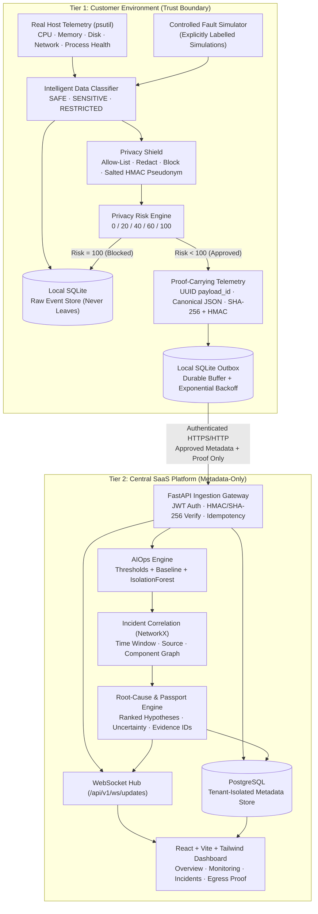

# CAUSAL-X Architecture

## Overview

CAUSAL-X implements a strict **two-tier privacy-first AIOps architecture**:

1. **Tier 1 (Customer Environment / Local Collector)**: Collects live infrastructure metrics (`psutil`) and optional controlled fault-injection events, retains raw logs/records locally in SQLite, classifies every field, redacts or blocks sensitive and restricted content, computes a transparent privacy risk score, generates canonical JSON + SHA-256/HMAC egress proofs, and buffers approved metadata locally when the central backend is unreachable.
2. **Tier 2 (Central SaaS Backend & Dashboard)**: Authenticates collectors and users, enforces multi-tenant isolation in PostgreSQL, verifies payload hashes/HMACs, guarantees idempotent ingestion by `payload_id`, orders out-of-order events by UTC `event_time`, detects anomalies (configurable rules + rolling baseline + `IsolationForest`), correlates incidents (`NetworkX`), synthesizes explainable root-cause hypotheses and Incident Passports, and broadcasts live updates via WebSockets.

## System Architecture Diagram

## Key Architectural Invariants

- **Trust Boundary Enforcement**: Privacy classification, redaction, and blocking occur exclusively inside Tier 1 before any outbound HTTP request object is constructed.
- **Event-Time Ordering**: Central storage indexes and queries by UTC `event_timestamp` while preserving `source_timezone` metadata, preventing out-of-order backlog replays from distorting metric charts.
- **Idempotency**: Every approved egress payload receives a deterministic/UUID `payload_id`; central ingestion deduplicates safely on `(tenant_id, payload_id)`.
